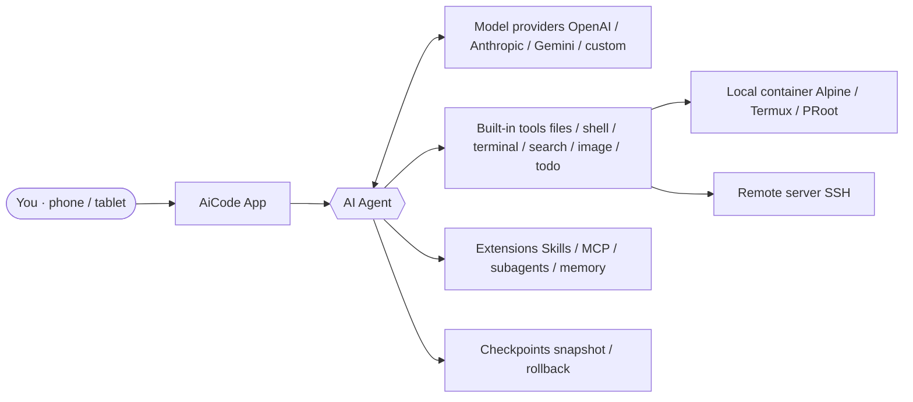

<div align="center">


# AiCode

**Put a complete AI coding workstation in your pocket**

A universal AI Coding Agent for Android · Linux dev environment · Local & remote SSH

[中文](README.zh.md) · [English](README.en.md)

<br/>

[](LICENSE)
[](https://github.com/hwsyyds666/Aicode-Glass/releases/latest)
[](https://github.com/hwsyyds666/Aicode-Glass/releases)
[](https://github.com/hwsyyds666/Aicode-Glass/stargazers)
[](https://github.com/hwsyyds666/Aicode-Glass/forks)

[Quick Start](#quick-start) · [Features](#features) · [Docs](https://aicode.murk.top) · [Download](https://github.com/hwsyyds666/Aicode-Glass/releases/latest) · [Feedback](#feedback--contribution)

</div>

<div align="center">

> **About this repository**
> This project is a secondary development fork of the original [jieapi/AiCode](https://github.com/jieapi/aicode). On top of the original it adds a **Liquid Glass UI**, **AI todo display position preferences**, a **floating glass title bar**, and other features, and fixes container channel and performance issues.
> Copyright of the original project belongs to the original author; this fork is open-sourced under the same [GPL-3.0](LICENSE) license.

---

## Preview

<p>
  
  
  
  <br/><b>Multi-provider management · Model config · Prompt library</b>
</p>

<p>
  
  
  
  <br/><b>AI chat · Image generation · Tool authorization · Personalization</b>
</p>

---

## Overview

AiCode is a universal AI coding agent that runs on Android. It packs a full Linux development environment into your phone: it bundles an Alpine Linux container and terminal, and the AI agent can read and write files, run shell commands and run build tools, so writing code, debugging and building all happen on-device.

You can also switch the execution backend to a remote SSH server, turning your phone into a mobile workstation for remote projects.

There is nothing to set up beforehand: install the app, configure a model under AI Vendors, and you can start coding right away — no computer and no environment to build yourself. AiCode ships no models and locks you into no vendor: models, keys and endpoints are entirely under your control.

## Highlights

<table>
  <tr>
    <td width="33%" valign="top">
      <h4>📱 Your phone is the workstation</h4>
      Built-in Alpine Linux container and multi-tab terminal, so development, debugging and building all happen locally
    </td>
    <td width="33%" valign="top">
      <h4>🌐 Local / remote backends</h4>
      Switch between the local container and remote SSH in one tap; commands, files and terminal all act on the chosen environment
    </td>
    <td width="33%" valign="top">
      <h4>⏪ Checkpoint rollback</h4>
      The agent records a checkpoint before changing code; roll back code, chat, or both in one tap
    </td>
  </tr>
  <tr>
    <td valign="top">
      <h4>🌿 Visual Git</h4>
      Status, branches, commit history, diffs and tags at a glance, plus staging, discard and credential setup
    </td>
    <td valign="top">
      <h4>🧩 Skills · MCP · Subagents</h4>
      Reusable skills, extensible MCP tools and parallel subagents; capability grows on demand
    </td>
    <td valign="top">
      <h4>🔑 Model-agnostic</h4>
      Compatible with the OpenAI / Anthropic / Gemini protocols, and supports custom providers too
    </td>
  </tr>
</table>

## How It Works



## New in This Branch

Compared with the original project, this branch focuses on visual experience and stability:

| New / improved | Description |
| :-- | :-- |
| 🪟 **Liquid Glass UI** | Built on [PrismalAGSL](https://github.com/styropyr0/PrismalAGSL), bringing refraction, chromatic dispersion and gradient glass effects |
| 📌 **AI todo display position** | Customize where the AI todo list appears in the UI |
| 🎐 **Floating glass title bar** | A floating title bar consistent with the Liquid Glass style |
| 🛠️ **Stability fixes** | Fixed container channel issues and improved performance |

## Features

<details open>
<summary><b>🤖 AI Agent</b></summary>
<br/>

- **A complete tool set** — File read/write/edit, shell execution, background terminal, code and web search, image recognition and todo lists; streaming output with live Markdown rendering and automatic context compression for long conversations
- **Parallel subagents** — Spawn subagents with their own isolated context to research, review or compare approaches in the background without blocking the chat; a read-only Explore subagent is built in, and you can define your own with a custom model, tool set and prompt
- **Checkpoints & undo** — A file snapshot is recorded before the agent edits code; roll back code, chat, or both in one tap
- **Skills & auto memory** — Global / project-level skills and long-term memory, so the AI can reuse experience and project conventions across sessions
- **MCP protocol** — Connect to local (stdio) and remote (HTTP) MCP servers to dynamically extend AI tool capabilities
- **Tool authorization & custom prompts** — Per-tool authorization rules; the system prompt can be overridden by the user and survives app upgrades

</details>

<details>
<summary><b>🔀 Three run modes</b></summary>
<br/>

| Mode | Purpose | Behavior |
| :-- | :-- | :-- |
| **BUILD** | Normal development | Runs according to your configured tool authorization rules |
| **PLAN** | Read-only planning | The tool layer blocks writes outright; analysis and plans only |
| **AUTO** | Approve everything | All operations are allowed automatically; only use in a fully trusted environment |

Switch the AI's permissions by how much you trust it: loosen up when you can, stay cautious when you should.

</details>

<details>
<summary><b>🧠 Models & providers</b></summary>
<br/>

- **Model-agnostic** — No bundled models and no vendor lock-in: configure models, keys and endpoints yourself
- **Protocol support** — Compatible with the OpenAI / Anthropic / Gemini protocols, with presets for several official providers and support for custom ones; model lists and pricing are customizable
- **Multiple keys** — Configure several keys per provider with sequential or round-robin rotation; reasoning effort is adjustable

</details>

<details>
<summary><b>💻 Development environment</b></summary>
<br/>

- **Built-in terminal & container** — A local Linux container built on Termux and PRoot with a built-in Alpine image; supports custom rootfs imports and host directory mounts; multi-tab terminals that can stay alive in the background
- **Remote SSH mode** — Use a remote server as the execution backend: commands, files and terminal all act on the remote project
- **File tree & code editor** — An indented file tree that opens files in a full-screen editor with syntax highlighting for mainstream languages and Markdown preview; `file:line` links in AI replies jump straight to that line, in both local and remote SSH workspaces
- **Git integration** — Visual management of status, branches, commit history, diffs and tags, plus staging, discarding changes, sign-off and credentials
- **Workspace sync** — SFTP / FTP synchronization with a built-in FTP server for desktop file management

</details>

<details>
<summary><b>✨ Experience</b></summary>
<br/>

- **Projects home** — Launch into a projects list: each project shows a file icon, or a phone icon when detected as an Android project; tap a project to open its chat, or use the + button to create one
- **Chat tools panel** — A single near-fullscreen panel from the chat header gathers Terminal, Build APK (Android projects only), Editor, Browser, Git, Network Request and Credentials; the sidebar keeps just Settings
- **Tablet & large screen** — Layout adapts to window width: a persistent sidebar on wide screens with code or terminal beside the chat, falling back to a single pane when narrow
- **Token stats** — Usage and cost estimates per provider and model, with a drill-down into individual calls
- **Appearance & language** — Light/dark themes, preset color schemes, Material You colors, custom background images, and a bilingual (Chinese/English) UI
- **Network proxy** — Configure a global proxy and per-provider proxies separately
- **Backup & restore** — Encrypted export/import of provider configs, credentials, chat history and workspace files

</details>

## Quick Start

**Requirements**: Android 8.0+ (API 26), arm64-v8a / x86_64

**1. Download and install**

Go to [GitHub Releases](https://github.com/hwsyyds666/Aicode-Glass/releases/latest) and pick the package for your device:

| Package | Device |
| :-- | :-- |
| `armsolo` | Real device (arm64-v8a) |
| `x86solo` | Emulator (x86_64) |
| `universal` | Universal package; use when unsure |

**2. Three steps to get going**

1. Go to **Settings → AI Vendors** and configure your model, key and endpoint
2. Under **Container & Images**, choose a local container or remote SSH
3. **Create a session** and start chatting

> 📖 For a more detailed quick start, user manual and advanced guides, see the [online docs](https://aicode.murk.top) (same source as the in-app docs).

## Build From Source

```bash
git clone https://github.com/hwsyyds666/Aicode-Glass.git
cd AiCode
./gradlew assembleDebug
```

Build artifacts are written under `app/build/outputs/apk/`. JDK and the Android SDK must be installed beforehand.

## Project Structure

```text
AiCode
├── app/                # Main Android app
├── terminal-emulator/  # Terminal emulator core (based on Termux)
├── terminal-view/      # Terminal view component (based on Termux)
├── prismalrepo/        # PrismalAGSL Liquid Glass library (local Maven repo)
├── docs/               # Icons, screenshots and other doc assets
└── docs-site/          # Online docs site source
```

## Star History

If AiCode is helpful to you, a ⭐ Star is welcome — it helps more developers discover the project.

[](https://www.star-history.com/#hwsyyds666/Aicode-Glass&Date)

## Feedback & Contribution

- 🐞 **Bug reports**: open an [Issue](https://github.com/hwsyyds666/Aicode-Glass/issues) with reproduction steps, device model and OS version to help us locate it
- 💡 **Feature requests**: discuss new features or improvements in [Issues](https://github.com/hwsyyds666/Aicode-Glass/issues) first
- 🔧 **Contributing code**: [Pull Requests](https://github.com/hwsyyds666/Aicode-Glass/pulls) are welcome
- 💬 **Community**: the original project's [AiCode QQ group](https://qm.qq.com/q/ByvqODJdIs) (group number: 1107110698) for tips and chat

### Contributors

<a href="https://github.com/hwsyyds666/Aicode-Glass/graphs/contributors">
  
</a>

## Acknowledgements

- **[jieapi/AiCode](https://github.com/jieapi/aicode)** — Original project, the foundation of this fork
- [OpenCode](https://github.com/anomalyco/opencode) — Terminal-based AI coding tool, the core inspiration for this project
- [Termux](https://github.com/termux/termux-app) — Android terminal emulator, provided terminal components and PRoot solution
- [Kelivo](https://github.com/Chevey339/kelivo) — Cross-platform LLM chat client, AI conversation UI design reference
- [PrismalAGSL](https://github.com/styropyr0/PrismalAGSL) — AGSL Liquid Glass effect library

## License

This project is licensed under [GPL-3.0](LICENSE). Third-party component copyright notices are detailed in [NOTICE](NOTICE).

</div>

<div align="center">

<sub>Made with ❤️ on Android</sub>

</div>
